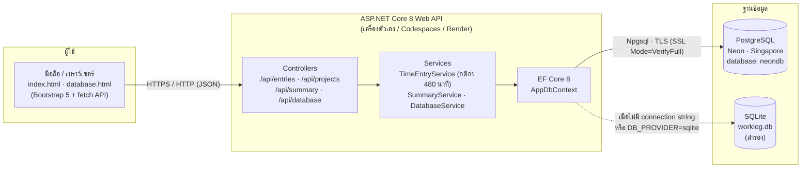

# ระบบบันทึกเวลาปฏิบัติงาน (Work Time Log)

ระบบสำหรับนักศึกษา 1 คน ใช้บันทึกเวลาที่ใช้กับงาน/โครงการในแต่ละวัน จำกัดเวลารวมไม่เกิน **480 นาทีต่อวัน**
ใช้งานได้ทั้งบนคอมพิวเตอร์และมือถือ (responsive)

| ส่วน | เทคโนโลยี |
|---|---|
| Backend | ASP.NET Core Web API (.NET 8) ภาษา C# |
| Database | **PostgreSQL บน Neon** (หลัก) หรือ SQLite `worklog.db` (สำรอง / ใช้งานออฟไลน์) + Entity Framework Core 8 (Code-First + Migrations) |
| Frontend | HTML + CSS + JavaScript (fetch API) + Bootstrap 5 (mobile-first) อยู่ใน `wwwroot` |
| API Docs | Swagger (Swashbuckle) |
| Test | xUnit + SQLite in-memory |

## สถาปัตยกรรม

แยกเซิร์ฟเวอร์ฐานข้อมูลออกจากตัวแอป: ตัวแอปจะรันที่ไหนก็ได้ (เครื่องตัวเอง / Codespaces / Render) แล้วต่อมาที่ฐานข้อมูลเดียวกันบน Neon



### การเลือกฐานข้อมูล

| เงื่อนไข | ฐานข้อมูลที่ใช้ |
|---|---|
| `DB_PROVIDER=postgres` | PostgreSQL (ต้องมี `ConnectionStrings:Default`) |
| `DB_PROVIDER=sqlite` | SQLite (`DB_PATH` หรือ `worklog.db`) |
| ไม่ได้ตั้ง `DB_PROVIDER` และ **มี** `ConnectionStrings:Default` | PostgreSQL |
| ไม่ได้ตั้ง `DB_PROVIDER` และ **ไม่มี** `ConnectionStrings:Default` | SQLite |

`ConnectionStrings:Default` อ่านจาก **dotnet user-secrets** (บนเครื่อง) หรือ environment variable **`ConnectionStrings__Default`** (Codespaces / Render)
**ไม่มี connection string หรือรหัสผ่านอยู่ในไฟล์ใด ๆ ของโปรเจกต์** และแอปไม่แสดงรหัสผ่านใน log / หน้าเว็บ (แสดงแค่ host กับชื่อ database)

### ทำไม migrations แยก 2 ชุด

EF Core migration ผูกกับ provider: ชนิดคอลัมน์ (`TEXT`/`INTEGER` ของ SQLite กับ `date`/`boolean`/`timestamptz` ของ PostgreSQL), identity, collation ต่างกัน จึงใช้ DbContext ลูก 2 ตัวที่ใช้ model เดียวกันจาก `AppDbContext`

| DbContext | Migrations | ใช้เมื่อ |
|---|---|---|
| `SqliteAppDbContext` | `Data/Migrations/Sqlite` | SQLite (migration เดิม ID เดิม → ไฟล์ `worklog.db` เก่ายังใช้ต่อได้) |
| `PostgresAppDbContext` | `Data/Migrations/Postgres` | PostgreSQL / Neon |

Service ทุกตัวใช้ `AppDbContext` จึงไม่ต้องรู้ว่าใช้ฐานข้อมูลอะไร ส่วน seed data ย้ายมาใส่ตอนเริ่มแอป (`DbSeeder`) **เฉพาะเมื่อตารางว่าง** แทนการเขียนไว้ใน migration เพื่อไม่ให้ชนกับข้อมูลที่ย้ายมา

ความต่างที่จัดการไว้: ชื่อโครงการห้ามซ้ำแบบไม่สนตัวพิมพ์ — SQLite ใช้ `COLLATE NOCASE`, PostgreSQL ใช้ ICU collation `case_insensitive` (nondeterministic) · `DateOnly` → `date` · `bool` → `boolean` · `DateTime` → `timestamptz` (UTC) · CHECK `Minutes 1–480` และ index ของ `WorkDate` เหมือนกันทั้งสองแบบ

---

## 1. โครงสร้างโปรเจกต์

```
WorkTimeLog/
├─ WorkTimeLog.sln
├─ .config/dotnet-tools.json         ← เครื่องมือ dotnet-ef (local tool)
├─ .vscode/                          ← tasks / launch สำหรับ VS Code
├─ src/WorkTimeLog.Api/
│  ├─ Models/            Project.cs, TimeEntry.cs              (Entity)
│  ├─ Data/              AppDbContext.cs (+ SqliteAppDbContext, PostgresAppDbContext)
│  │                     DatabaseSetup.cs (เลือก provider), DbSeeder.cs, SqliteToPostgresImporter.cs
│  │  └─ Migrations/     Sqlite/InitialCreate, Postgres/InitialCreate
│  ├─ Dtos/              Dtos.cs                               (DTO แยกจาก Entity)
│  ├─ Services/          TimeEntryService.cs  ← กติกาทางธุรกิจทั้งหมด
│  │                     SummaryService.cs, ProjectService.cs, Exceptions.cs
│  ├─ Filters/           ApiExceptionFilter.cs  (แปลง exception → HTTP 400/404)
│  ├─ Controllers/       ProjectsController, EntriesController, SummaryController
│  ├─ wwwroot/           index.html, css/site.css, js/app.js
│  ├─ Program.cs         Kestrel 0.0.0.0:5000, CORS, Swagger, auto-migrate
│  └─ appsettings.json
├─ tests/WorkTimeLog.Tests/
│  ├─ TestDb.cs                      ← SQLite in-memory
│  ├─ TimeEntryServiceTests.cs
│  └─ SummaryAndProjectTests.cs
├─ database/schema.sql               ← CREATE TABLE (SQLite) + seed
├─ database/schema.postgres.sql      ← สร้างจาก migration (dotnet ef migrations script)
├─ docs/ER-diagram.md                ← Mermaid erDiagram
├─ start-mobile.ps1                  ← รันเซิร์ฟเวอร์ + Cloudflare Tunnel
├─ Dockerfile, .dockerignore         ← สำหรับ deploy ด้วย Docker
├─ render.yaml                       ← Render Blueprint
└─ README.md
```

---

## 2. การติดตั้ง

1. ติดตั้ง **.NET 8 SDK** — ตรวจสอบด้วย
   ```powershell
   dotnet --version      # ต้องขึ้นต้นด้วย 8.
   ```
   ถ้ายังไม่มี ติดตั้งด้วยคำสั่ง (PowerShell)
   ```powershell
   winget install Microsoft.DotNet.SDK.8
   ```
   หรือดาวน์โหลดจาก <https://dotnet.microsoft.com/download/dotnet/8.0> แล้ว **ปิด–เปิด VS Code / Terminal ใหม่**
2. ติดตั้ง **VS Code** และ extension **C# Dev Kit** (VS Code จะแนะนำให้ติดตั้งอัตโนมัติเมื่อเปิดโฟลเดอร์)
3. เปิดโฟลเดอร์ `WorkTimeLog` ใน VS Code (File → Open Folder…)
4. คืนค่า package และเครื่องมือ
   ```powershell
   dotnet restore
   dotnet tool restore      # ติดตั้ง dotnet-ef ตามไฟล์ .config/dotnet-tools.json
   ```
5. ตั้งค่าการเชื่อมต่อ PostgreSQL (Neon) — ข้ามได้ถ้าจะใช้ SQLite

### 2.1 ตั้งค่า connection string บนเครื่องด้วย user-secrets

user-secrets เก็บค่าไว้นอกโฟลเดอร์โปรเจกต์ (`%APPDATA%\Microsoft\UserSecrets\<UserSecretsId>\secrets.json`) จึงไม่หลุดเข้า git

1. เข้า Neon Console → โปรเจกต์ → **Connect** → เลือก database `neondb`, role `neondb_owner` → เลือกรูปแบบ **.NET** แล้วกดคัดลอก
2. รันใน terminal (แทน `<connection string>` ด้วยค่าที่คัดลอกมา ใส่ในเครื่องหมาย `"` ทั้งก้อน)
   ```powershell
   dotnet user-secrets set "ConnectionStrings:Default" "<connection string>" --project src/WorkTimeLog.Api
   ```
3. ตรวจว่ามี key แล้ว **โดยไม่แสดงค่า**: ดูบรรทัด `ฐานข้อมูล : Postgres: <host>/neondb` ตอน `dotnet run`
   (อย่าใช้ `dotnet user-secrets list` ต่อหน้าคนอื่นหรือตอนแชร์หน้าจอ เพราะจะแสดงรหัสผ่าน)
4. ลบค่า: `dotnet user-secrets remove "ConnectionStrings:Default" --project src/WorkTimeLog.Api`

> user-secrets ใช้ได้เฉพาะ environment `Development` (ค่าเริ่มต้นของ `dotnet run`) ที่อื่นให้ใช้ environment variable `ConnectionStrings__Default`

### 2.2 ตั้งค่าใน GitHub Codespaces (Codespaces secret)

1. GitHub → รูปโปรไฟล์ → **Settings** → **Codespaces** (เมนูซ้าย หัวข้อ Code, planning, and automation)
2. หัวข้อ **Secrets** → **New secret**
3. **Name**: `ConnectionStrings__Default` (ขีดล่าง 2 ตัว) · **Value**: connection string จาก Neon
4. **Repository access** → เลือก repo `WorkTimeLog` → **Add secret**
5. Codespace ที่เปิดอยู่ต้อง **รีสตาร์ต** ถึงจะเห็น secret ใหม่ (Codespaces จะแจ้งให้ Reload) หรือ `Ctrl+Shift+P` → *Codespaces: Rebuild Container*
6. ตรวจใน terminal ของ Codespace **โดยไม่แสดงค่า**:
   ```bash
   [ -n "$ConnectionStrings__Default" ] && echo "มี secret แล้ว" || echo "ยังไม่มี"
   ```

### 2.3 ย้ายข้อมูลจาก SQLite เข้า PostgreSQL

```powershell
dotnet run --project src/WorkTimeLog.Api -- import-sqlite                 # ใช้ src/WorkTimeLog.Api/worklog.db
dotnet run --project src/WorkTimeLog.Api -- import-sqlite path\to\other.db # หรือระบุไฟล์เอง
```

- รัน migration กับ PostgreSQL ให้ก่อน แล้วคัดลอก Projects และ TimeEntries **โดยคง Id เดิม** และรีเซ็ต identity sequence ให้ต่อจาก Id มากสุด
- **รันซ้ำได้**: แถวที่มี Id อยู่แล้วจะถูกข้าม ข้อมูลไม่ซ้ำ
- แสดงจำนวนแถวก่อน/หลังย้าย และเวลารวม เพื่อเทียบว่าตรงกัน
- ควรย้าย **ก่อน** รันแอปกับฐานข้อมูลใหม่ครั้งแรก (ถ้ารันแอปก่อน ตารางว่างจะถูกใส่ข้อมูลตัวอย่าง แล้ว Id 1–5 จะชนกับข้อมูลเดิม)
- ถ้าต่อ Neon แล้วขึ้น `Timeout during reading attempt` ให้ตรวจว่า VPN / firewall ไม่ได้บล็อกพอร์ต **5432**

> สร้าง migration ใหม่ในอนาคต (ต้องทำทั้ง 2 ชุด):
> ```powershell
> dotnet ef migrations add <Name> --project src/WorkTimeLog.Api --context SqliteAppDbContext   -o Data/Migrations/Sqlite
> dotnet ef migrations add <Name> --project src/WorkTimeLog.Api --context PostgresAppDbContext -o Data/Migrations/Postgres
> dotnet ef migrations script --project src/WorkTimeLog.Api --context PostgresAppDbContext -o database/schema.postgres.sql
> ```
> ไม่ต้องใช้ `dotnet ef database update` — แอปรัน `Migrate()` ให้เองตอนเริ่ม

> คำสั่งที่ใช้สร้างโปรเจกต์นี้ตั้งแต่ต้น (อ้างอิง)
> ```powershell
> dotnet new sln -n WorkTimeLog
> dotnet new webapi -n WorkTimeLog.Api -o src/WorkTimeLog.Api -f net8.0 --use-controllers
> dotnet new xunit  -n WorkTimeLog.Tests -o tests/WorkTimeLog.Tests -f net8.0
> dotnet sln add src/WorkTimeLog.Api tests/WorkTimeLog.Tests
> dotnet add src/WorkTimeLog.Api package Microsoft.EntityFrameworkCore.Sqlite -v 8.0.11
> dotnet add src/WorkTimeLog.Api package Microsoft.EntityFrameworkCore.Design -v 8.0.11
> dotnet add src/WorkTimeLog.Api package Swashbuckle.AspNetCore -v 6.6.2
> dotnet add tests/WorkTimeLog.Tests reference src/WorkTimeLog.Api
> dotnet add tests/WorkTimeLog.Tests package Microsoft.EntityFrameworkCore.Sqlite -v 8.0.11
> dotnet new tool-manifest
> dotnet tool install dotnet-ef --version 8.0.11
> dotnet ef migrations add InitialCreate --project src/WorkTimeLog.Api -o Data/Migrations
> ```

---

## 3. วิธีรัน

เปิด Terminal ใน VS Code (`` Ctrl+` ``) ที่โฟลเดอร์ `WorkTimeLog` แล้วพิมพ์

```powershell
dotnet run --project src/WorkTimeLog.Api
```

- ครั้งแรกโปรแกรมจะรัน migration อัตโนมัติ (`db.Database.Migrate()`) และสร้างไฟล์ `src/WorkTimeLog.Api/worklog.db` พร้อมข้อมูลตัวอย่าง
- หน้าเว็บ: <http://localhost:5000>
- Swagger: <http://localhost:5000/swagger>
- หยุดโปรแกรม: กด `Ctrl+C`
- หรือกด **F5** ใน VS Code (ใช้ `.vscode/launch.json`) / เมนู Terminal → Run Task → `run`

รัน Unit Test:

```powershell
dotnet test
```

ถ้าต้องการล้างข้อมูลทั้งหมดกลับเป็นข้อมูลตัวอย่าง: หยุดโปรแกรม แล้วลบไฟล์ `src/WorkTimeLog.Api/worklog.db` จากนั้นรันใหม่

---

## 4. วิธีเปิดบนมือถือ

แอปฟังที่ `http://0.0.0.0:5000` (ทุก network interface) มือถือที่ต่อ **Wi-Fi เดียวกัน** กับคอมพิวเตอร์จึงเข้าได้

### 4.1 หา IP ของเครื่องด้วย `ipconfig`

```powershell
ipconfig
```

ดูหัวข้อ **Wireless LAN adapter Wi-Fi** แล้วจดค่า **IPv4 Address** เช่น

```
Wireless LAN adapter Wi-Fi:
   IPv4 Address. . . . . . . . . . . : 192.168.1.45
```

> ตอนโปรแกรมเริ่มทำงาน จะพิมพ์ลิงก์ "บนมือถือ" ทุก IP ของเครื่องให้ด้วย
> ถ้ามีหลายรายการ ให้เลือก IP ของ Wi-Fi (ไม่ใช่ของ VirtualBox, VPN หรือ WSL เช่น `192.168.56.x`)

### 4.2 เปิด Windows Firewall port 5000

เปิด **PowerShell แบบ Run as Administrator** แล้วพิมพ์

```powershell
New-NetFirewallRule -DisplayName "WorkTimeLog 5000" -Direction Inbound -Protocol TCP -LocalPort 5000 -Action Allow -Profile Private
```

หรือใช้คำสั่งแบบเดิม

```cmd
netsh advfirewall firewall add rule name="WorkTimeLog 5000" dir=in action=allow protocol=TCP localport=5000
```

> - ถ้า Wi-Fi ถูกตั้งเป็น **Public network** ให้เปลี่ยนเป็น **Private** (Settings → Network & internet → Wi-Fi → ชื่อ Wi-Fi → Network profile type → Private) หรือเปลี่ยน `-Profile Private` เป็น `-Profile Any`
> - ครั้งแรกที่รัน Windows อาจถามสิทธิ์เครือข่าย ให้กด **Allow**
> - ลบกฎเมื่อเลิกใช้: `Remove-NetFirewallRule -DisplayName "WorkTimeLog 5000"`
> - Wi-Fi ของสถานศึกษา/ที่สาธารณะบางแห่งเปิด *client isolation* ทำให้เครื่องคุยกันไม่ได้ ให้ใช้ Hotspot จากมือถือแทน

### 4.3 เปิดบนมือถือ

เปิดเบราว์เซอร์บนมือถือ แล้วพิมพ์ `http://<IP ของเครื่อง>:5000` เช่น `http://192.168.1.45:5000`
(มือถือต้องต่ออินเทอร์เน็ตได้ด้วย เพราะหน้าเว็บโหลด Bootstrap จาก CDN)

### 4.4 เปิดผ่านอินเทอร์เน็ตด้วย Cloudflare Tunnel (ไม่ต้องอยู่ Wi-Fi เดียวกัน)

ใช้สคริปต์ `start-mobile.ps1` ที่ root ของโปรเจกต์ สคริปต์จะ

1. รันเซิร์ฟเวอร์ (`dotnet run --project src/WorkTimeLog.Api`) ถ้ายังไม่ได้รัน
2. เปิด `cloudflared tunnel --url http://localhost:5000`
3. แสดงลิงก์ `https://xxxx.trycloudflare.com` และคัดลอกลง clipboard ให้

ต้องติดตั้ง cloudflared ก่อน (ครั้งเดียว): `winget install --id Cloudflare.cloudflared`

```powershell
cd C:\dev\WorkTimeLog
powershell -ExecutionPolicy Bypass -File .\start-mobile.ps1
```

- เปิดลิงก์ที่แสดงบนมือถือได้เลย (ใช้ 4G/5G หรือ Wi-Fi ไหนก็ได้) ถ้าเปิดแล้วขึ้น error ให้รอประมาณ 10–30 วินาทีแล้วลองใหม่
- **ลิงก์จะเปลี่ยนทุกครั้ง** ที่รันสคริปต์ใหม่ (เป็น Quick Tunnel แบบไม่ต้องมีบัญชี Cloudflare)
- **หยุด**: กด `Ctrl+C` ในหน้าต่างที่รันสคริปต์ เซิร์ฟเวอร์และ tunnel จะหยุดพร้อมกัน
- ถ้าปิดหน้าต่างไปแล้วแต่ยังมีโปรแกรมค้าง ให้รัน
  ```powershell
  powershell -ExecutionPolicy Bypass -File .\start-mobile.ps1 -Stop
  ```
  (คำสั่งนี้หยุด `WorkTimeLog.Api` และ `cloudflared` **ทุกตัว** ในเครื่อง)
- log อยู่ในโฟลเดอร์ `logs/` (`server.log`, `tunnel.log`)
- ⚠️ ระบบนี้ไม่มี login ใครที่ได้ลิงก์ไปจะเห็นและแก้ไขข้อมูลได้ทั้งหมด อย่าส่งลิงก์ต่อ และหยุด tunnel เมื่อเลิกใช้
- แอปไม่ได้ใช้ `UseHttpsRedirection` (Cloudflare ทำ HTTPS ให้แล้ว แล้วส่งต่อมาที่แอปเป็น HTTP) ลิงก์จึงไม่วน redirect

### 4.5 Deploy ขึ้น Render.com (แผนฟรี)

ไฟล์ที่เกี่ยวข้อง: `Dockerfile`, `.dockerignore`, `render.yaml`

| Environment variable | ค่าบน Render | ความหมาย |
|---|---|---|
| `PORT` | Render ตั้งให้เอง (ปกติ 10000) | พอร์ตที่แอปฟัง (ไม่มีค่า → 5000) |
| `ConnectionStrings__Default` | connection string จาก Neon (ตั้งใน Render Dashboard → Environment ห้ามใส่ใน render.yaml) | ใช้ PostgreSQL บน Neon |
| `DB_PATH` | `/app/data/worklog.db` | path ไฟล์ SQLite (ใช้เมื่อไม่มี connection string) |
| `ASPNETCORE_ENVIRONMENT` | `Production` | |

- ตอนเริ่มทำงาน แอปรัน `Database.Migrate()` และใส่ข้อมูลตัวอย่างเฉพาะเมื่อตารางว่าง
- Swagger เปิดทุก environment: `https://<ชื่อแอป>.onrender.com/swagger`
- ถ้าตั้ง `ConnectionStrings__Default` ข้อมูลอยู่บน Neon **ไม่หายเมื่อรีสตาร์ต** ถ้าไม่ตั้ง จะใช้ SQLite ในเครื่อง Render ซึ่งรีเซ็ตทุกครั้งที่ deploy / รีสตาร์ต
- อัปเดต: แก้โค้ด → `git add -A` → `git commit -m "..."` → `git push` → Render build และ deploy ให้อัตโนมัติ

---

## 5. กติกาทางธุรกิจ

ตรวจใน `Services/TimeEntryService.cs` (ไม่อยู่ใน controller จึงทดสอบด้วย unit test ได้)

| # | กติกา |
|---|---|
| 1 | เวลารวมต่อวัน (WorkDate เดียวกัน) ต้องไม่เกิน 480 นาที |
| 2 | ไม่นับรายการที่ยกเลิก (`IsCancelled = true`) ในการรวมเวลา |
| 3 | ตอนแก้ไข: `เวลารวม = (ผลรวมรายการอื่นที่ไม่ถูกยกเลิกในวันใหม่ ไม่นับรายการที่กำลังแก้) + Minutes ใหม่` ถ้าย้ายวันที่จะตรวจกับวันใหม่ |
| 4 | ยกเลิกแบบ soft cancel (ไม่ลบจริง) กู้คืนได้ และตอนกู้คืนต้องตรวจกติกา 480 นาทีอีกครั้ง |
| 5 | Minutes ต้องมากกว่า 0 และไม่เกิน 480 |
| 6 | ผิดกติกา → HTTP 400 `{ "message": "..." }` ภาษาไทย เช่น `เวลารวมวันที่ 2026-11-18 จะเป็น 510 นาที เกินกำหนด 480 นาที (เหลือได้อีก 30 นาที)` |

กติกาเพิ่มเติม: รายละเอียดงานต้องไม่ว่างและยาวไม่เกิน 500, หมายเหตุยาวไม่เกิน 500, ชื่อโครงการห้ามซ้ำ (ไม่สนตัวพิมพ์เล็ก/ใหญ่), รายการที่ยกเลิกแล้วต้องกู้คืนก่อนจึงแก้ไขได้

---

## 6. รายการ API

Base URL: `http://localhost:5000` — ทดลองได้ที่ `/swagger` หรือไฟล์ `src/WorkTimeLog.Api/WorkTimeLog.Api.http`

| Method | Endpoint | คำอธิบาย |
|---|---|---|
| GET | `/api/projects` | รายชื่อโครงการทั้งหมด |
| POST | `/api/projects` | เพิ่มโครงการ — body `{ "name": "..." }` |
| GET | `/api/entries?date=YYYY-MM-DD` | รายการของวันนั้น (รวมรายการที่ยกเลิก) |
| GET | `/api/entries?from=YYYY-MM-DD&to=YYYY-MM-DD` | รายการในช่วงวันที่ |
| GET | `/api/entries/{id}` | ดูรายการเดียว |
| POST | `/api/entries` | เพิ่มรายการ |
| PUT | `/api/entries/{id}` | แก้ไขรายการ |
| POST | `/api/entries/{id}/cancel` | ยกเลิกรายการ (soft cancel) |
| POST | `/api/entries/{id}/restore` | กู้คืนรายการ (ตรวจ 480 นาทีอีกครั้ง) |
| GET | `/api/summary/daily?date=YYYY-MM-DD` | เวลารวม, เวลาที่เหลือจาก 480, จำนวนรายการ |
| GET | `/api/summary/by-project?from=...&to=...` | เวลารวมแยกตามโครงการ |

### API ดูฐานข้อมูล (อ่านอย่างเดียว) — ใช้กับหน้า `/database.html`

| Method | Endpoint | คำอธิบาย |
|---|---|---|
| GET | `/api/database/info` | ชนิดฐานข้อมูล, path, ขนาดไฟล์, จำนวนแถวแต่ละตาราง, เวลารวม (ไม่นับที่ยกเลิก), จำนวนที่ยกเลิก |
| GET | `/api/database/projects` | ทุกแถวของ Projects (+ จำนวนรายการ/เวลารวม) |
| GET | `/api/database/entries` | ทุกแถวของ TimeEntries รวมที่ยกเลิก + ชื่อโครงการ เรียงวันล่าสุดก่อน |
| GET | `/api/database/daily-totals` | ผลรวมนาทีต่อวัน, เวลาที่เหลือจาก 480, สถานะเกินหรือไม่ |
| GET | `/api/database/export/entries.csv` | ดาวน์โหลด CSV (UTF-8 with BOM เปิดใน Excel แล้วภาษาไทยไม่เพี้ยน) |
| GET | `/api/database/download` | ดาวน์โหลดสำเนา `worklog.db` (checkpoint WAL ก่อน แล้วส่งไฟล์สำเนาชั่วคราว) |

> ⚠️ หน้านี้ไม่มี login ใครเปิดลิงก์ได้ก็ดาวน์โหลดฐานข้อมูลทั้งไฟล์ได้

ตัวอย่าง body ของ POST/PUT `/api/entries`

```json
{
  "workDate": "2026-11-18",
  "projectId": 1,
  "description": "เขียนโปรแกรมส่วน API",
  "minutes": 90,
  "note": "ทำต่อพรุ่งนี้"
}
```

ตัวอย่างผลลัพธ์ `/api/summary/daily?date=2026-11-18`

```json
{ "date": "2026-11-18", "totalMinutes": 270, "remainingMinutes": 210, "maxMinutes": 480, "entryCount": 2, "cancelledCount": 0 }
```

ตัวอย่าง error (HTTP 400)

```json
{ "message": "เวลารวมวันที่ 2026-11-18 จะเป็น 510 นาที เกินกำหนด 480 นาที (เหลือได้อีก 210 นาที)" }
```

| HTTP | ความหมาย |
|---|---|
| 200 / 201 | สำเร็จ |
| 400 | ผิดกติกา / ข้อมูลไม่ถูกต้อง (มี `message` ภาษาไทย) |
| 404 | ไม่พบรายการ |

---

## 7. หน้าจอ (Frontend)

- **แท็บบันทึกเวลา**: เลือกวันที่ (ค่าเริ่มต้นวันนี้, ปุ่มเลื่อนวันก่อน/ถัดไป) + progress bar "ใช้ไป X / 480 นาที"
  สีเขียว → เหลือง (≥ 75%) → แดง (≥ 90%)
- ฟอร์มเพิ่ม/แก้ไข: วันที่, โครงการ (dropdown + ปุ่มเพิ่มโครงการใหม่), รายละเอียดงาน, เวลา (นาที) พร้อมปุ่มลัด 15/30/60/120/ที่เหลือ, หมายเหตุ
- รายการของวัน: มือถือแสดงเป็น **card** / จอกว้าง (≥ 768px) แสดงเป็น **table** มีปุ่ม แก้ไข / ยกเลิก / กู้คืน
- รายการที่ยกเลิกแสดงสีจางและขีดฆ่า และไม่นับในยอดรวม
- ข้อความ error จาก API แสดงเป็นกล่องสีแดงเหนือฟอร์ม/ด้านบนหน้า
- **แท็บสรุปตามโครงการ**: เลือกช่วงวันที่ (มีปุ่มลัด สัปดาห์นี้ / เดือนนี้ / 30 วันล่าสุด)

---

## 8. Unit Tests และผลการทดสอบ

รันด้วย `dotnet test` — ใช้ **SQLite in-memory** (สร้างฐานข้อมูลใหม่ทุก test)

**ผลการทดสอบ: ผ่าน 27 / 27 (Failed 0)** — ทดสอบเมื่อ 2026-11-18 บน .NET SDK 8.0.428

| # | กรณีทดสอบ | ผลที่คาดหวัง | ผลลัพธ์ |
|---|---|---|---|
| 1 | เพิ่มรายการให้รวมได้พอดี 480 นาที (200 + 280) | ผ่าน | ✅ Passed |
| 2 | เพิ่มรายการจนรวมได้ 481 นาที (400 + 81) | ไม่ผ่าน + ข้อความ "…จะเป็น 481 นาที เกินกำหนด 480 นาที (เหลือได้อีก 80 นาที)" | ✅ Passed |
| 3 | รายการยกเลิก 300 นาที + รายการปกติ 400 นาที | ผ่าน (ไม่นับรายการยกเลิก, รวม 400) | ✅ Passed |
| 4 | แก้ไขจาก 200 เป็น 280 ในวันที่มีรายการอื่น 200 นาที | ผ่าน (รวม 480 ไม่ใช่ 680) | ✅ Passed |
| 5 | แก้ไขจาก 200 เป็น 281 ในวันที่มีรายการอื่น 200 นาที | ไม่ผ่าน (481) ค่าเดิมไม่เปลี่ยน | ✅ Passed |
| 6 | แก้ไขโดยย้ายไปวันที่ที่เต็มแล้ว (480) | ไม่ผ่าน รายการยังอยู่วันเดิม | ✅ Passed |
| 7 | กู้คืนรายการที่ยกเลิกแล้วทำให้เกิน 480 (300 + 400) | ไม่ผ่าน ยังคงสถานะยกเลิก | ✅ Passed |
| 8 | Minutes = 0, -1, -60 (3 กรณี) | ไม่ผ่าน | ✅ Passed (3/3) |
| 9 | Minutes = 481 ในรายการเดียว | ไม่ผ่าน | ✅ Passed |
| 10 | แก้ไข Minutes เป็น 0 | ไม่ผ่าน | ✅ Passed |
| 11 | แก้ไขย้ายไปวันที่ยังว่าง | ผ่าน วันเดิมลดลง วันใหม่เพิ่มขึ้น | ✅ Passed |
| 12 | กู้คืนรายการที่ไม่ทำให้เกิน 480 | ผ่าน | ✅ Passed |
| 13 | ยกเลิกเป็น soft cancel | ข้อมูลยังอยู่ในฐานข้อมูล | ✅ Passed |
| 14 | แก้ไขรายการที่ยกเลิกแล้ว | ไม่ผ่าน | ✅ Passed |
| 15 | รายละเอียดงานว่าง / ยาวเกิน 500 | ไม่ผ่าน | ✅ Passed |
| 16 | แก้ไข/ยกเลิกรายการที่ไม่มีอยู่ | NotFound (HTTP 404) | ✅ Passed |
| 17 | สรุปรายวันไม่นับรายการยกเลิก | รวม 120, เหลือ 360 | ✅ Passed |
| 18 | สรุปแยกตามโครงการในช่วงวันที่ | จัดกลุ่มถูกต้อง ไม่นับนอกช่วง | ✅ Passed |
| 19 | ชื่อโครงการซ้ำ (ไม่สนตัวพิมพ์/ช่องว่าง) | ไม่ผ่าน | ✅ Passed |
| 20 | ช่วงวันที่กลับด้าน (to < from) | ไม่ผ่าน | ✅ Passed |
| 21 | daily-totals ไม่นับรายการที่ยกเลิก (100 + ยกเลิก 300) | รวม 100, เหลือ 380 | ✅ Passed |
| 22 | entries คืนรายการที่ยกเลิกด้วย + ชื่อโครงการ + เรียงวันล่าสุดก่อน | มีรายการที่ยกเลิก | ✅ Passed |
| 23 | daily-totals แสดงสถานะเกิน 480 (ข้อมูล 500 นาที) | IsOverLimit = true | ✅ Passed |
| 24 | info นับจำนวนแถวและเวลารวม (seed data) | 3 โครงการ, 5 รายการ, 450 นาที | ✅ Passed |
| 25 | CSV มี BOM, escape `,` `"` และกันสูตร Excel | ถูกต้อง | ✅ Passed |

ข้อ 1–8 คือกรณีที่โจทย์กำหนด ข้อ 9–20 เป็นกรณีเพิ่มเติม ข้อ 21–25 ทดสอบหน้าดูฐานข้อมูล

---

## 9. ข้อมูลตัวอย่าง (Seed data)

| โครงการ | |
|---|---|
| 1 | โครงงานคอมพิวเตอร์ |
| 2 | ฝึกงาน / สหกิจศึกษา |
| 3 | ทบทวนบทเรียนและการบ้าน |

| วันที่ | รายการ | รวม |
|---|---|---|
| 2026-11-17 | 120 + 60 นาที (+ รายการยกเลิก 90 นาที ไม่นับ) | 180 นาที |
| 2026-11-18 | 180 + 90 นาที | 270 นาที |

ดูโครงสร้างตารางได้ที่ [`database/schema.sql`](database/schema.sql) และ [`docs/ER-diagram.md`](docs/ER-diagram.md)
