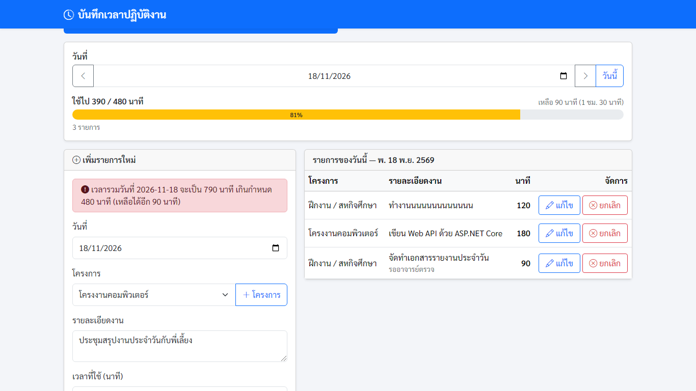
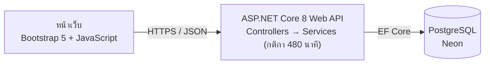

# ระบบบันทึกเวลาปฏิบัติงาน (Work Time Log)

ผู้จัดทำ: **นายกิตติศักดิ์ ชละเอม**

## สำหรับกรรมการ

- 🌐 ระบบที่ใช้งานได้จริง: **<https://worktimelog-nine.vercel.app>** (ใช้ได้ทั้งคอมและมือถือ)
- 💻 โค้ด: [`src/`](src/)
- 🗄️ สคริปต์ฐานข้อมูล: [`database/submission/`](database/submission/) (PostgreSQL และ MySQL)
- 📘 คู่มือการใช้งาน: [`docs/manual/`](docs/manual/) (PDF และ Word)
- 🔒 หน้าผู้ดูแลระบบ (ดูฐานข้อมูล): <https://worktimelog-nine.vercel.app/admin> (ต้องใช้รหัสผ่าน ขอได้จากผู้จัดทำ)
- pass admin_admin

## ลองทดสอบเงื่อนไขด้วยตัวเอง

เปิด <https://worktimelog-nine.vercel.app> แล้วเลือกวันที่ที่ยังไม่มีรายการ

1. เพิ่มรายการ **300 นาที** → บันทึกได้ (ใช้ไป 300 / 480)
2. เพิ่มอีก **200 นาที** → ถูกปฏิเสธ เพราะรวม 500 เกิน 480 (ระบบบอกว่าเหลือได้อีก 180 นาที)
3. แก้ไขรายการ 300 เป็น **250** แล้วเพิ่ม 200 อีกครั้ง → บันทึกได้ (รวม 450 เพราะใช้ค่าใหม่แทนค่าเดิม)
4. กด **ยกเลิก** รายการใดรายการหนึ่ง → ยอดรวมลดลงทันที (ไม่นับรายการที่ยกเลิก และกด "กู้คืน" ได้)

## เหตุผลการออกแบบ

- ยกเลิกแบบ **soft cancel** (ไม่ลบจริง) เพื่อเก็บประวัติและกู้คืนได้
- ตรวจกติกา 480 นาทีที่ **Service ฝั่ง server** ไม่พึ่ง frontend จึงเรียก API ตรง ๆ ก็ข้ามกติกาไม่ได้
- แยกฐานข้อมูลไป **PostgreSQL บน Neon** เพื่อให้ข้อมูลไม่หายเมื่อ deploy ใหม่หรือเซิร์ฟเวอร์รีสตาร์ต

## ภาพรวม

เว็บแอปให้นักศึกษาฝึกงานบันทึกเวลาที่ใช้กับแต่ละงาน/โครงการในแต่ละวัน เพิ่ม แก้ไข ยกเลิก และกู้คืนรายการได้
แสดงเวลาที่ใช้ไปของวันเป็นแถบสี และสรุปเวลาแยกตามโครงการ มีหน้าแอดมิน (ต้องใช้รหัสผ่าน) สำหรับดูฐานข้อมูล

## ภาพหน้าจอ

| หน้าหลัก | แจ้งเตือนเมื่อเวลารวมเกิน 480 นาที |
|---|---|
|  |  |

## กติกาของระบบ

1. เวลารวมต่อวันไม่เกิน **480 นาที**
2. แก้ไขรายการแล้วใช้ **ค่าใหม่แทนค่าเดิม** ก่อนรวม (เช่น อื่น 200 + แก้ 200→280 = 480 ไม่ใช่ 680)
3. **ไม่นับรายการที่ยกเลิก** ในเวลารวม (ยกเลิกแบบ soft cancel กู้คืนได้)

## เทคโนโลยี

C# ASP.NET Core 8 · PostgreSQL (Neon) · Bootstrap 5 · xUnit · Vercel

## สถาปัตยกรรม



## วิธีรันบนเครื่อง

```powershell
winget install Microsoft.DotNet.SDK.8
git clone https://github.com/Folktalomlok/WorkTimeLog.git; cd WorkTimeLog
dotnet run --project src/WorkTimeLog.Api      # เปิด http://localhost:5000 (ไม่ตั้งค่าฐานข้อมูล = ใช้ SQLite)
dotnet test
```

## ผลการทดสอบ

xUnit ผ่าน **40/40** กรณี

---

รายละเอียดสำหรับนักพัฒนา (API, ผลทดสอบทุกกรณี, ตั้งค่า user-secrets, deploy): [docs/DEVELOPER.md](docs/DEVELOPER.md)
