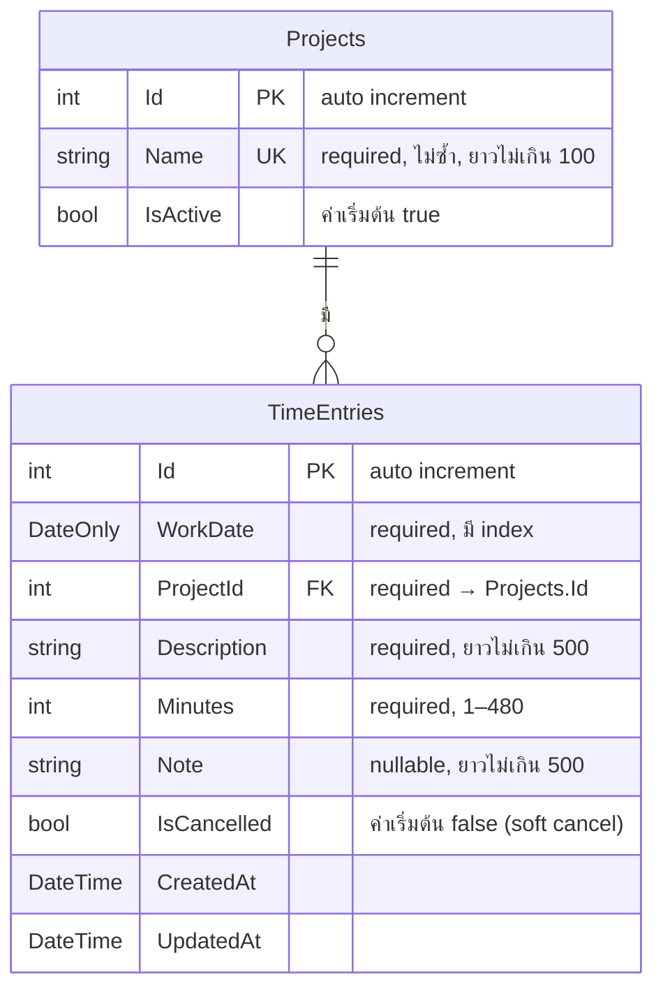

# ER Diagram — ระบบบันทึกเวลาปฏิบัติงาน (Work Time Log)

## ความสัมพันธ์

| ความสัมพันธ์ | ประเภท | คำอธิบาย |
|---|---|---|
| Projects → TimeEntries | 1 : N | โครงการ 1 รายการมีรายการบันทึกเวลาได้หลายรายการ แต่ละรายการบันทึกเวลาต้องอยู่ใน 1 โครงการเสมอ (ห้ามลบโครงการที่ยังมีรายการ — `ON DELETE RESTRICT`) |

## Index / Constraint

| ตาราง | ชื่อ | ประเภท | คอลัมน์ |
|---|---|---|---|
| Projects | PK_Projects | Primary key | Id |
| Projects | IX_Projects_Name | Unique index (NOCASE) | Name |
| TimeEntries | PK_TimeEntries | Primary key | Id |
| TimeEntries | IX_TimeEntries_WorkDate | Index | WorkDate |
| TimeEntries | IX_TimeEntries_ProjectId | Index (FK) | ProjectId |
| TimeEntries | CK_TimeEntries_Minutes | Check | `Minutes > 0 AND Minutes <= 480` |

## กติกาที่ตรวจในชั้น Service

- เวลารวมต่อวัน (WorkDate เดียวกัน) ของรายการที่ `IsCancelled = false` ต้องไม่เกิน 480 นาที
- ตอนแก้ไข: `รวม = (รายการอื่นในวันใหม่ที่ไม่ถูกยกเลิก ไม่นับตัวเอง) + Minutes ใหม่`
- ตอนกู้คืน: ตรวจกติกา 480 นาทีอีกครั้ง
